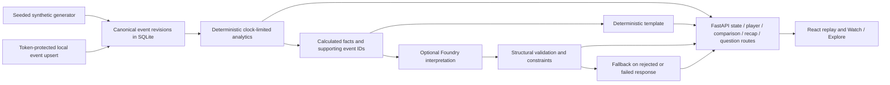

# MatchLens architecture and evidence boundaries

## Local data flow

The diagram shows functional boundaries, not independently deployed services. The backend runs as one local FastAPI process. SQLite is in memory unless `MATCHLENS_EVENT_DB` names a local file. The frontend is React/TypeScript; Vite handles development, and FastAPI can mount `frontend/dist` for same-origin built-demo serving. There is no broker or streaming ingestion service.

## Contracts and modules

| Responsibility | Source | Boundary |
| --- | --- | --- |
| Synthetic events and models | `backend/matchlens/synthetic.py`, `models.py` | Seeded fictional event/season generation; rule-based realism, not calibrated simulation. |
| Canonical revisions | `backend/matchlens/store.py`, `api.py` | Highest revision per event; reads recompute from canonical events. Local upserts require a token. |
| Counts, comparisons, player profiles, moments, alerts | `analytics.py`, `profiles.py`, `moments.py`, `alerts.py` | Deterministic facts limited by viewer clock; event association is not causal or tracking evidence. |
| Questions, recap and optional AI | `api.py`, `summaries.py`, `explainer.py`, `workflow.py`, `providers.py` | Template by default; optional single interpretation or experimental specialist selection, with fallback. |
| UI clocks and response presentation | `frontend/src/App.tsx`, `replay.ts`, `api.ts`, `components/` | Viewer-selected replay time, player/sequence inspection and output provenance. Watch scene is an SVG illustration. |
| Local serving | `serving.py`, `scripts/Start-MatchLens.ps1` | Loopback static assets/API; Windows launcher optionally loads whitelisted Foundry configuration. |

Primary routes are `GET /api/health`, `GET /api/matches`, `GET /api/matches/{id}/state`, `GET /api/matches/{id}/players/{player_id}`, `GET /api/matches/{id}/comparison`, `POST /api/matches/{id}/questions`, `GET /api/matches/{id}/recap`, and `POST /api/matches/{id}/events`. Inspect `/docs` locally for actual request schemas. Health configuration is not proof of successful cloud connectivity.

## Optional cloud boundary

The current match analyst uses `canonical_single`: one optional model selects a canonical, evidence-bound conclusion. A separate optional **viewing guide** ranks at most three IDs from a deterministic action catalog via `POST /api/matches/{id}/guidance`. The catalog supplies concepts, sequences, questions and exposure-aware comparisons; the guide cannot write match claims. Local ranking is available without Foundry. It is not a checker or a mandatory second call. Branches are viewer-selected interests. All requests pin clock/source; corrections invalidate publication and forward playback preserves the displayed snapshot. See [viewing-guide.md](viewing-guide.md) for source freezes, tests, recorded execution and unproven benefit.

Foundry uses the Azure AI Projects/OpenAI-compatible SDK path with Azure identity. Backend-only settings name the project/deployment; credentials never belong in browser bundles. Default template operation makes no live model request. Single policy bypasses model calls for direct counts; specialist orchestration is an experimental comparison. Responses expose generation mode, and failures/rejections preserve useful deterministic output.

The recorded deployment is `gpt-4.1-mini`. October 21 traces demonstrate actual connectivity and usage; they do not demonstrate accepted semantic quality. Valid IDs and numeric tokens can still be attached to an incorrect subject/window or unsupported inference. Current acceptance must therefore include semantic review, duration-aware comparison and fresh-seed evaluation. See [evaluation.md](evaluation.md) and [foundry-fresh-verification.json](foundry-fresh-verification.json). No multi-agent SDK, production access control, availability SLA or deployment reliability is claimed.

## Revisions, time and limitations

An event correction changes subsequent canonical API reads. It does not establish an external live feed or notification stream. Every response carries a canonical source version. The viewer rejects mixed snapshots and clears old narratives after observing a correction. Before/after cards show actual durations; model context includes precomputed rates and player active minutes. SQLite reads and writes share a lock. These behaviors have regression coverage; no push notification stream exists. The generated halves assume 45 minutes, and real stoppage time needs additional metadata. Synthetic season rankings are not real league rankings. Offline accounts, dependency installation, public hosting, licensing and a recorded video are distinct delivery concerns; the local ZIP does not settle them.

October22 correction behavior: paused visible views poll the opaque revision endpoint every15seconds; changed source versions invalidate answers/recaps/sequences and reload facts at the selected clock. Manual refresh is available. This is polling, not server push.
